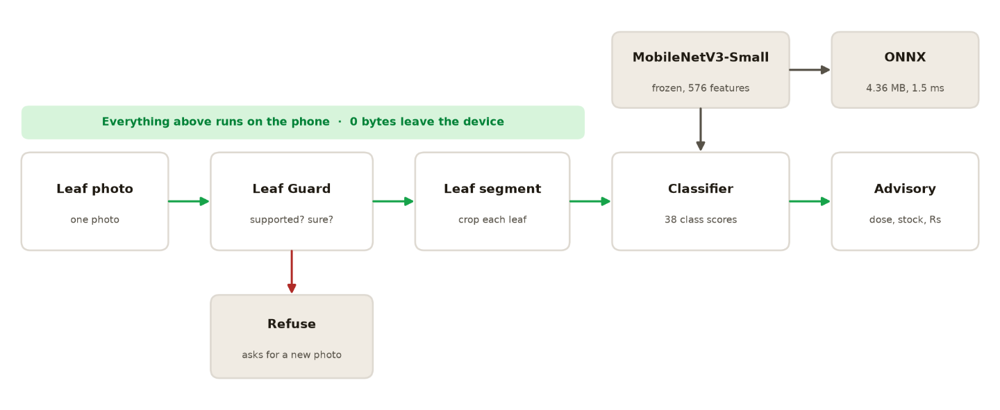

# Crop Disease Detector

An **offline, on-device** crop-disease detector. Photograph a leaf, and the app
names the disease and tells the farmer what to do about it. It gives the treatment, the
stock check, and the rupee estimate. No internet, no account, and no photo ever
leaves the device.



*Photo → Leaf Guard → leaf segment → MobileNetV3-Small (frozen) → 38 classes → advisory.
Every stage runs on the device; 0 bytes leave the phone.*

---

## What it does

- **Leaf Guard**: refuses the photo if it is not a leaf of a supported crop,
  instead of guessing.
- **Auto-crop and multi-leaf**: finds the leaf (or several leaves) in the frame
  and classifies each one.
- **38 classes across 14 crops**: 12 healthy classes and 26 disease/pest
  classes, covering 20 distinct disease names.
- **Local advisory**: treatment text, a seed/stock inventory check, and an
  estimated rupee saving per recommendation.
- **100% offline**: a 4.36 MB ONNX model. Measured at **0.7 ms per image** and
  **15 MB of RAM** on a Windows 11 laptop.
- **Hindi and English**: the advisory, the labels and a spoken answer.
- **Gradio demo**: upload a photo and see the whole pipeline run.

Measured on held-out PlantVillage images: **90.1%** accuracy on 1,140 unseen
leaves.

---

## Measured resource cost

Every number below was produced by `profile_model.py` on a Windows 11 laptop.
not estimated. Run it yourself to reproduce:

```bash
python profile_model.py --runs 50
```

| Measure | Value |
| --- | --- |
| Model file | 4.36 MB (fp32 ONNX) |
| RAM to load and run | **15 MB** |
| Peak process RAM | 71 MB |
| CPU | **58% of one core** |
| Latency | **0.7 ms** median, 0.8 ms p95 |
| Throughput | **1,404 images/sec** |
| Runtime | onnxruntime 1.30.0 (CPU) |
| Cores available | 12 |
| GPU | none |
| Network calls at runtime | 0 |

For a phone-class comparison, run it pinned to one thread:

```bash
python profile_model.py --runs 50 --threads 1
```

---

## Quick start

```bash
python -m venv venv
# Windows:  .\venv\Scripts\activate
# macOS/Linux:  source venv/bin/activate
pip install -r requirements.txt
python app.py
```

Open the local URL Gradio prints. The model file `crop_disease.onnx` and
`class_names.json` ship with the repo, so no training is needed to run the demo.

See `SETUP_GUIDE.md` for the long version, including the common setup errors.

---

## How it works

```
  leaf photo
      |
      v
  Leaf Guard          is this a crop we support?  no -> refuse
      |
      v
  Leaf segment        find the leaf, or each leaf in the frame
      |
      v
  Classifier           MobileNetV3-Small (frozen) + a trained linear head
      |                -> 38 class scores, on-device, 0.7 ms
      v
  Advisory agent       treatment + inventory + rupee estimate
      |
      v
  decision for the farmer
```

The backbone is ImageNet-pretrained MobileNetV3-Small, used frozen as a feature
extractor. Only a small classifier head is trained. That is why the whole thing
is 4.36 MB, needs 15 MB of RAM, and runs on a CPU.

---

## Honest limits

Read these before quoting any number.

- **It learned on lab photos.** PlantVillage images are single leaves on plain
  backgrounds. On a real field photo the model is much less reliable: a
  PlantVillage-trained model scored 13–15% when tested on real field images in
  the PlantDoc benchmark, and about 30% after fine-tuning on real photos.
- **It covers 14 crops only.** Wheat, rice, sugarcane, cotton and pulses are
  missing, and those cover most of India's fields. An unsupported crop gets a confident wrong
  answer today; a supported-crop gate is the planned fix.
- **Hindi and English only.** The advisory and the UI ship in both. Regional
  languages (Marathi, Telugu, Bengali and the rest) are not there yet. The spoken
  answer uses the browser's built-in Hindi voice, which some machines do not have,
  the text is always shown either way.
- **Some classes are weak.** Blueberry, raspberry and soybean have a healthy
  class but no disease class; orange and squash have a disease class but no
  healthy class.
- **Sibling crops get confused.** Tomato and potato share late blight and
  early blight, and their leaves look almost identical. The model has no notion
  of "crop", so it can name the wrong host. The app now says this explicitly and
  notes that the treatment is the same, because the pathogen is the same.
- **No field trial.** Nobody has measured this in a real season yet.

The fixes are known and written down. See `TRAIN_GUIDE.md`.

---

## Training your own model

Start with **`TRAIN_GUIDE.md`**, a full walkthrough from an empty laptop to a
new `crop_disease.onnx`.

```bash
# 1. bring public data onto disk (once, needs internet)
python download_data.py plantdoc --out raw
python download_data.py strip-exif --dir raw     # remove camera/GPS metadata

# 2. split into train/val
python prepare_data.py --raw raw --out data

# 3. train and export
python train_pipeline_v2.py --data data --out .
```

| File | Role |
| --- | --- |
| `TRAIN_GUIDE.md` | the full step-by-step guide |
| `download_data.py` | fetch public datasets; strip image metadata |
| `prepare_data.py` | raw photos -> train/val split |
| `check_dataset.py` | report class counts and flag weak classes |
| `train_pipeline_v2.py` | features -> head -> ONNX, with augmentation and per-class metrics |
| `train_pipeline.py` | the original, simpler trainer, kept for reference |

Adding a class is a data job, not a code job: drop the photos into
`raw/<ClassName>/` and re-run the three commands. The class name is the folder
name.

---

## Project structure

| File | What it is |
| --- | --- |
| `app.py` | the Gradio demo and the request path |
| `predict.py` | runs the ONNX model on a single image |
| `guard.py` | Leaf Guard: supported-crop check and confidence gate |
| `leaf_segment.py` | leaf detection and cropping |
| `farm_tools.py` | treatment text per class, and the rupee estimate |
| `seed_inventory.py` | local stock check |
| `mcp_farm_server.py` | local MCP tools for the advisory agent |
| `profile_model.py` | measures RAM, CPU, latency and throughput; writes `model_metrics.json` |
| `crop_disease.onnx` | the trained model |
| `class_names.json` | class names in the model's output order |
| `model_metrics.json` | accuracy figures and the measured profiling block |
| `architecture.png` | the pipeline diagram above |

---

## Privacy and offline behaviour

- The app makes **no network calls**. Unplug the network and it still works.
- No photo, no location and no account ever leaves the device.
- Under **DPDPA 2023** there is almost nothing to protect, because no personal
  data is collected at all.
- `download_data.py` is the only part that touches the network, it is a one-time
  developer step, and it never runs inside the app.

---

## Data, licences and credits

This project is built on public research datasets. Credit them if you reuse this
work.

### PlantVillage

- **Citation:** Mohanty, S. P., Hughes, D. P., & Salathé, M. (2016). *Using deep
  learning for image-based plant disease detection.* Frontiers in Plant Science,
  7, 1419. doi:10.3389/fpls.2016.01419
- **Repository:** https://github.com/spMohanty/PlantVillage-Dataset
- **Licence: check which release you downloaded.** This one needs care:
  - The original 2015 release announcement states the images are released under
    **CC BY-SA 3.0**, and adds that *algorithms trained on the data fall under
    the same licence* (Hughes & Salathé, arXiv:1511.08060).
  - The GitHub repository and the common Kaggle mirrors are listed as
    **CC0 1.0 (public domain)**.
  - These two do not agree. If your copy came from the CC BY-SA release, a model
    trained on it is arguably **CC BY-SA** as well, which would require you to
    share it under the same licence. If it came from a CC0 mirror, there is no
    such condition.

### PlantDoc

- **Citation:** Singh, D., Jain, N., Jain, P., Kayal, P., Kumawat, S., & Batra,
  N. (2020). *PlantDoc: A Dataset for Visual Plant Disease Detection.*
  CoDS-COMAD 2020, 249–253. doi:10.1145/3371158.3371196 (IIT Gandhinagar)
- **Repository:** https://github.com/pratikkayal/PlantDoc-Dataset
- **Licence:** Creative Commons Attribution 4.0 International (**CC BY 4.0**).
  attribution required, **no share-alike**. Real-world field photos, and the
  reason this project knows how far it still has to go.
- **Note:** PlantDoc was used as a **benchmark**, not as training data. The model
  is trained on PlantVillage only.

### Models and libraries

| Component | Licence |
| --- | --- |
| MobileNetV3 (torchvision, ImageNet weights) | BSD-3-Clause |
| PyTorch, torchvision | BSD-3-Clause |
| ONNX | Apache-2.0 |
| ONNX Runtime | MIT |
| Gradio | Apache-2.0 |
| Pillow | HPND |
| NumPy | BSD-3-Clause |

Check each package for the exact licence text before you redistribute.

### Your own photos

Photos you shoot yourself are yours. Run `python download_data.py strip-exif
--dir raw` on any mixed folder to remove camera and GPS metadata before you share
it.

---

## Roadmap

1. **Field photos and a retrain**: the single biggest accuracy gain.
2. **A supported-crop gate**: a small binary filter so unsupported crops are
   refused rather than mislabelled.
3. **Hindi and a spoken answer**: for farmers who cannot read English.
4. **One KVK pilot**: fifty farmers, one season, one measured number.

---

## Licence

Project code: add the licence you intend to publish under here (for example MIT
or Apache-2.0). Remember that the licence you choose may be constrained by the
PlantVillage question above.
